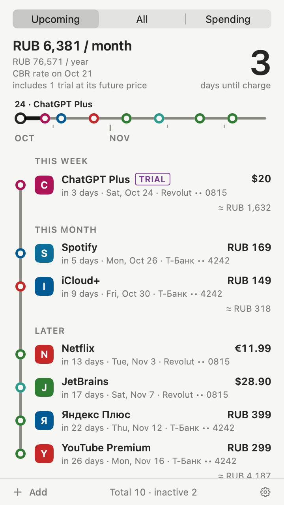
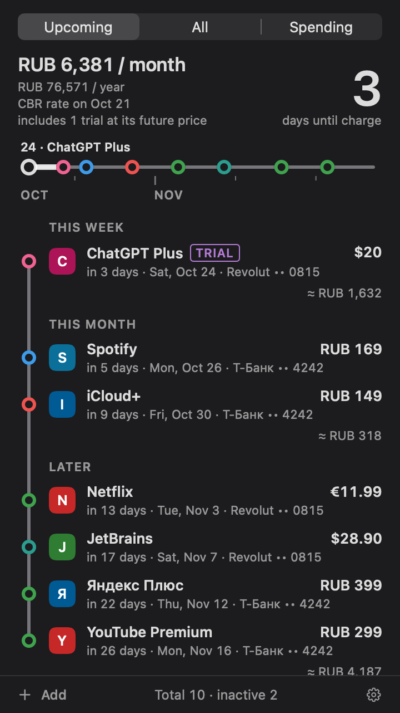
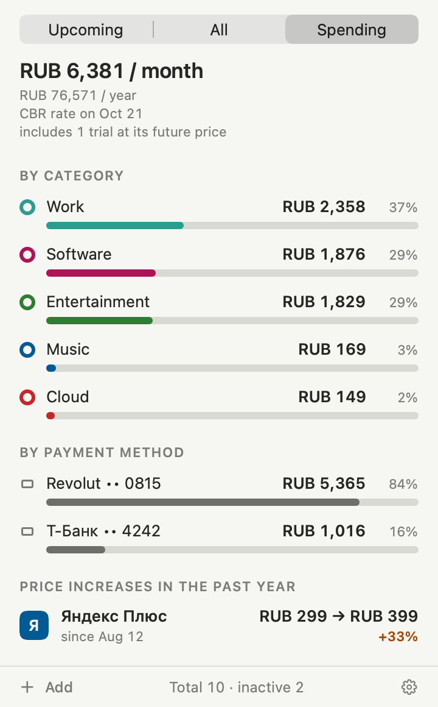
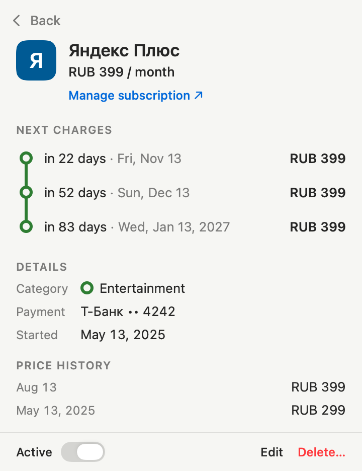
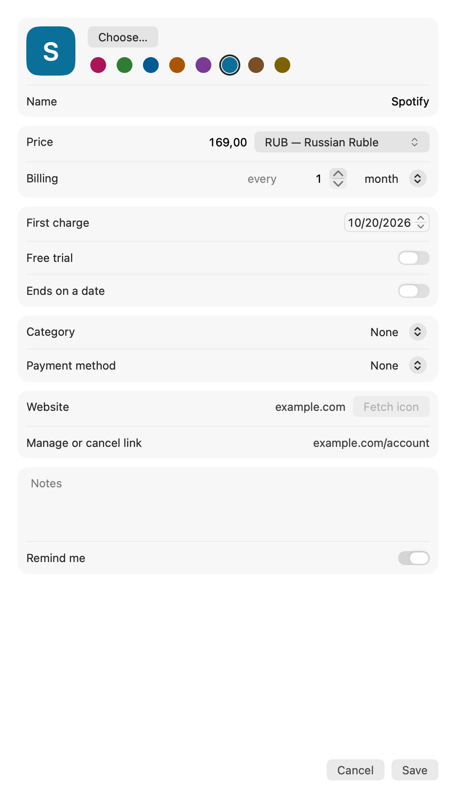
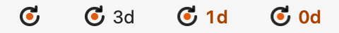

<p align="center">
  
</p>

<h1 align="center">Subus</h1>

<p align="center">
  <b>Know what will be charged, how much and when — before it happens.</b><br>
  A native macOS menu-bar subscription tracker. Local, private, no account.
</p>

<p align="center">
  
  
  
  <a href="LICENSE"></a>
</p>

<p align="center">
  English · <a href="README.ru.md">Русский</a>
</p>

<p align="center">
  
  &nbsp;
  
</p>

---

## Why Subus

If you pay for a dozen services, you lose count: a forgotten trial, a service you stopped using, a charge on the day the card is empty. Subus lives next to the clock and keeps the answer one click away.

- **Nothing comes as a surprise.** Reminders 5, 3 and 1 day before every charge (configurable) and before every trial ends, with a "Manage subscription" action (shown when the subscription has a manage link).
- **Honest totals.** Monthly and yearly spend in your base currency, converted at the Central Bank of Russia rate. A currency the bank does not list is left out and flagged, never silently miscounted.
- **At a glance.** The menu bar can show the days until the next charge.
- **Private by construction.** No account, no server, no bank access. Your data stays on your Mac.

## Features

| | |
|---|---|
| **Upcoming** | A timeline of charges grouped as Today & tomorrow / This week / This month / Later (up to 30 days; each subscription once, at its nearest charge), with monthly and yearly totals on top. |
| **Reminders** | 5, 3 and 1 day before each charge by default (0–30 days, configurable), at 10:00 by default. Trial ends get their own reminder: cancel now if you do not need it. |
| **Currencies** | Any ISO currency; totals use the daily CBR rates, cached, so they work offline. |
| **Spending** | Monthly breakdown by category and by payment method, plus a list of price increases over the last year. |
| **Subscriptions** | Name, logo (your own image, the site's icon on request, or a monogram), price, billing cycle (N days, weeks, months or years), first charge, trial end, end date, category, payment method (a free-text label, never card numbers), website, manage/cancel link, price history, notes. |
| **Import / export** | JSON (complete, with logos — a real backup) and CSV (UTF-8, opens in Excel and Numbers). Import shows a preview before anything changes. |
| **Safe data** | Atomic writes, an automatic backup and recovery from a corrupted file. |
| **Languages** | English and Russian, following the system language, with an in-app override. |

<p>
  
  &nbsp;
  
  &nbsp;
  
</p>

<p>
  
</p>

## Install

1. Download `Subus.dmg` from [Releases](https://github.com/aesarva/subus/releases) and open it.
2. Drag **Subus** onto the **Applications** shortcut, then launch it. It lives in the menu bar; a Dock icon shows only while an add, edit or Settings window is open.
3. Releases are not yet notarized, so Gatekeeper blocks the first launch. On macOS 15–26: open the app and dismiss the warning, then go to **System Settings → Privacy & Security**, scroll to **Security**, click **Open Anyway** and confirm. On macOS 14, right-click the app and choose **Open**.

Requires macOS 14 Sonoma or later. Liquid Glass on macOS 26+, a plain material on 14–15.

## Privacy and network

Subus has no account, no analytics and no server of its own. The sandboxed app talks to the network in exactly two cases:

- **`cbr.ru`** — the daily exchange rates (`https://www.cbr.ru/scripts/XML_daily.asp`), on launch and then about every 12 hours when the cache is older than 24 hours. Offline, the cached rate is used.
- **The subscription's own site** — only when you click **Fetch icon** in the editor: its home page and the HTTPS addresses it points to for its icon (for example, a CDN).

Everything else stays local. Your data lives in the app's sandbox container:

```
~/Library/Containers/io.github.aesarva.Subus/Data/Library/Application Support/Subus/
```

(Settings → Data → Show data folder opens it.) The sandbox entitlements are only `app-sandbox`, `network.client` and `files.user-selected.read-write` (for import, export and logo files you pick). See [SECURITY.md](SECURITY.md).

## Build from source

Requirements: Xcode 26 or later and

```sh
brew install xcodegen
```

```sh
make test       # SubusCore tests and plist lint
make build      # generate the Xcode project and build (Debug)
make run        # build and launch; extra flags: make run ARGS='-SeedDemoData -OpenPanelOnLaunch'
make app        # Release universal build (arm64 + x86_64), hardened runtime → build/Subus.app
make dmg        # make app + dist/Subus-<VERSION>.dmg without a Developer ID
make snapshots  # render the UI state matrix (light/dark × en/ru) into build/snapshots/
```

`scripts/build-app.sh` honours `ARCHS`, `VERSION` and `SIGN_IDENTITY` (default `-`, ad-hoc).

### Signed release

With a **Developer ID Application** certificate in your keychain and notarization credentials stored once:

```sh
xcrun notarytool store-credentials Subus --apple-id <you@example.com> --team-id <TEAMID>
scripts/release.sh 0.1.0     # build, sign, notarize app and DMG, staple, check Gatekeeper
```

Without a certificate, `scripts/release.sh 0.1.0 --unsigned` (or `make dmg`) checks everything except signing and notarization.

### Project layout

```
App/                    SwiftUI/AppKit app: status item, panel, editor, settings, services
Packages/SubusCore/     data model, schedule, reminders, rates, import/export, storage (+ tests)
scripts/                build-app.sh and release.sh
docs/                   images, design sketches, spec and implementation plan
PRODUCT.md, DESIGN.md   product context and the visual system
```

## Contributing

See [CONTRIBUTING.md](CONTRIBUTING.md) for the branch workflow and the pre-merge checklist, and [CHANGELOG.md](CHANGELOG.md) for what changed.

## License

Subus is free software under the [GNU General Public License v3.0](LICENSE). Third-party service logos are never bundled; logos come only from you or, on your request, from the service's own site.
