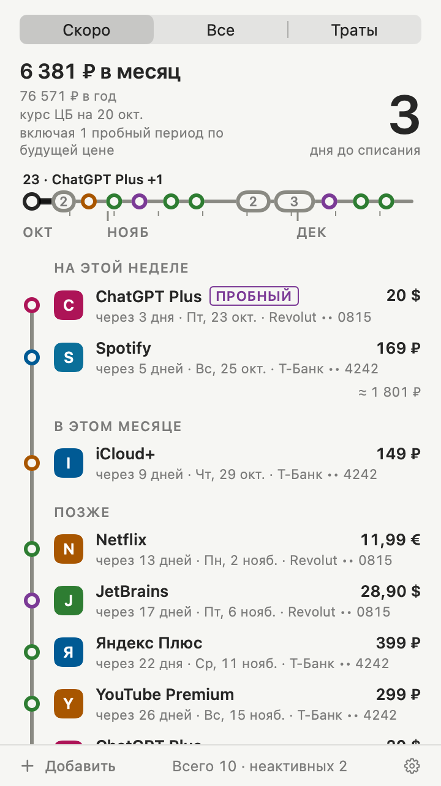
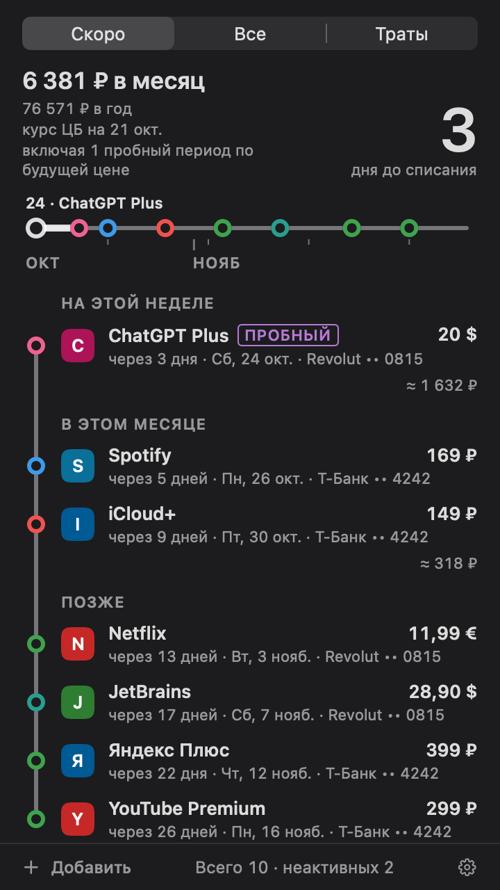
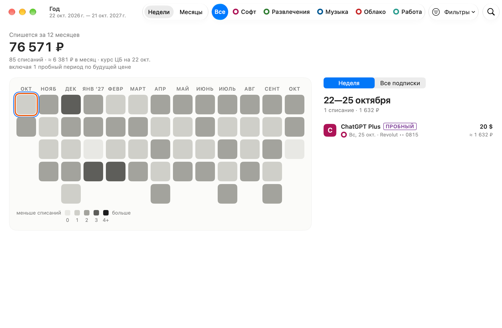
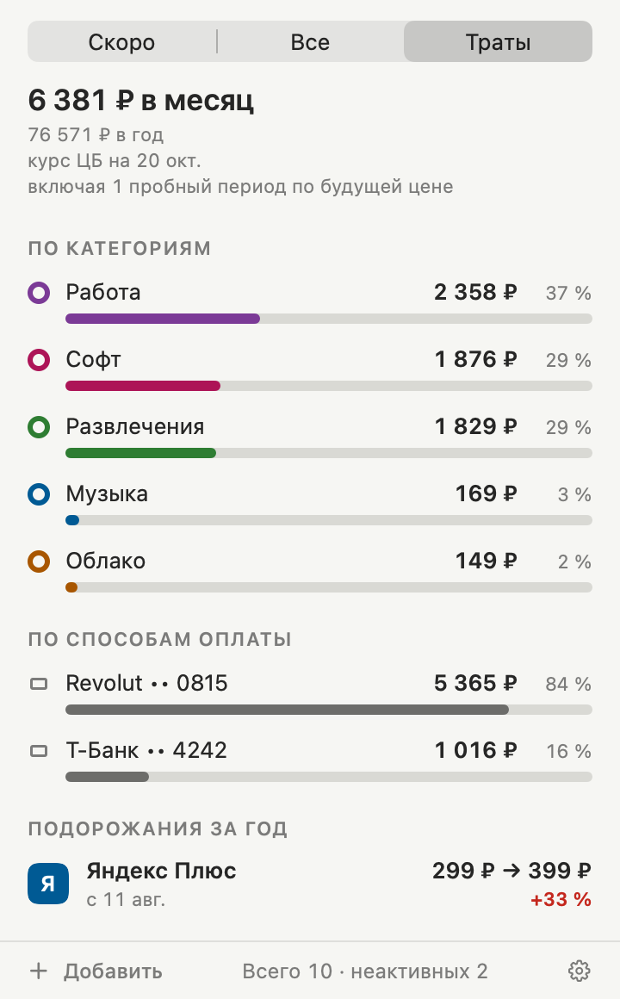
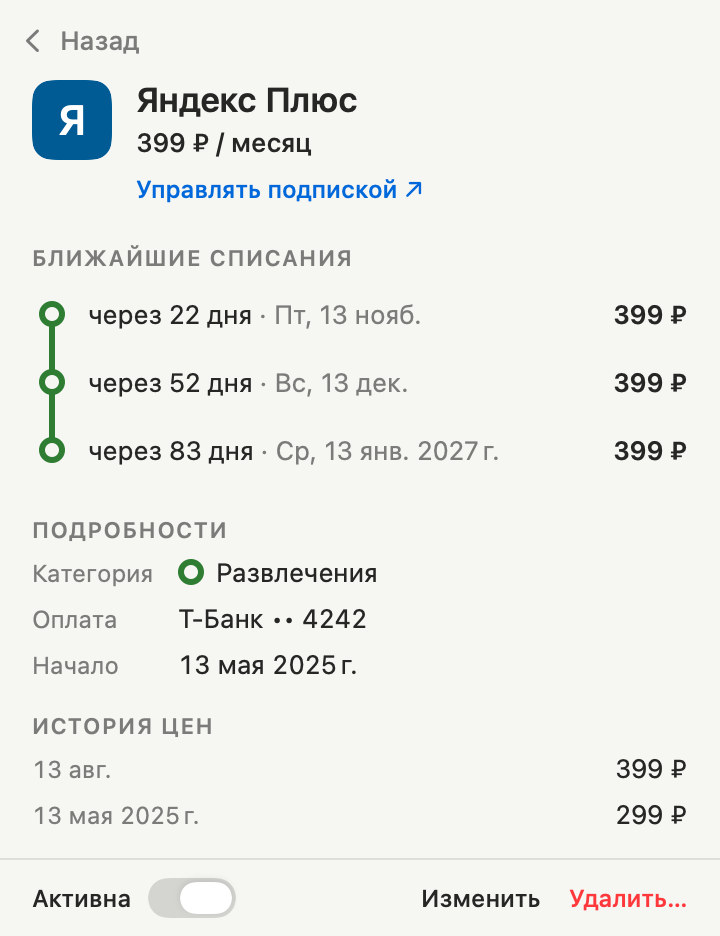
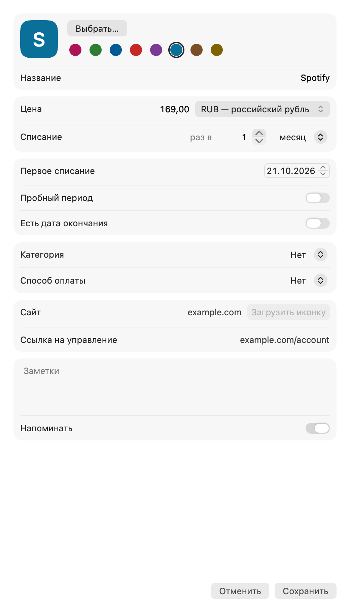
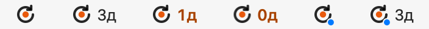

<p align="center">
  
</p>

<h1 align="center">Subus</h1>

<p align="center">
  <b>Знайте, что, сколько и когда спишется, — заранее.</b><br>
  Нативный трекер подписок в строке меню macOS. Локально, приватно, без аккаунта.
</p>

<p align="center">
  
  
  
  <a href="LICENSE"></a>
</p>

<p align="center">
  <a href="README.md">English</a> · Русский
</p>

<p align="center">
  
  &nbsp;
  
</p>

---

## Зачем Subus

Когда платите за десяток сервисов, сбиваетесь со счёта: забытый пробный период, сервис, которым давно не пользуетесь, списание в день, когда на карте пусто. Subus живёт рядом с часами, и ответ всегда в одном клике.

- **Ничто не застаёт врасплох.** Напоминания за 5, 3 и 1 день до каждого списания (настраивается) и до конца каждого пробного периода, с действием «Управлять подпиской» (оно появляется, если у подписки задана ссылка управления).
- **Честные итоги.** Траты в месяц и в год в основной валюте по курсу Центробанка. Валюта, которой нет у ЦБ, в сумму не входит и помечается — её никогда не считают молча неверно.
- **С первого взгляда.** В строке меню можно показывать число дней до ближайшего списания.
- **Приватно по построению.** Без аккаунта, сервера и доступа к банку. Данные остаются на вашем Mac.

## Возможности

| | |
|---|---|
| **Скоро** | Лента списаний по группам: сегодня и завтра / на этой неделе / в этом месяце / позже (до 30 дней; каждая подписка один раз, ближайшим списанием), сверху — итоги за месяц и за год. |
| **Год** | Окно с ближайшими 12 месяцами в виде календаря-сетки по неделям или месяцам, тон ячейки зависит от числа списаний. Фильтры, боковая панель со списаниями периода и страница каждой подписки. Открывается из подвала панели, быстрого меню или по ⌘Y, а также по клику по иконке в Dock, пока Subus в Dock (повторный запуск из Finder или Launchpad тоже открывает его). |
| **Напоминания** | По умолчанию за 5, 3 и 1 день до каждого списания (0–30 дней, настраивается), в 10:00. У конца пробного периода своё напоминание: отмените сейчас, если не нужно. |
| **Валюты** | Любая валюта ISO; итоги считаются по ежедневным курсам ЦБ с кэшем, поэтому работают и без сети. |
| **Траты** | Разбивка за месяц по категориям и способам оплаты и список подорожавших за год подписок. |
| **Подписки** | Название, логотип (своё изображение, иконка сайта по запросу или монограмма), цена, период (N дней, недель, месяцев или лет), первое списание, конец пробного периода, дата окончания, категория, способ оплаты (произвольная подпись, никаких номеров карт), сайт, ссылка управления, история цен, заметки. |
| **Обновления** | Раз в сутки Subus проверяет новую версию на GitHub. «Установить и перезапустить» в панели скачивает, проверяет и ставит её одним нажатием; точка на значке в строке меню показывает, что обновление ждёт. Автоматическую проверку можно выключить в «Настройки → Основные». |
| **Импорт / экспорт** | JSON (полный, с логотипами — настоящая резервная копия) и CSV (UTF-8, открывается в Excel и Numbers). Перед импортом показывается предпросмотр. |
| **Сохранность данных** | Атомарная запись, автоматический бэкап и восстановление после повреждения файла. |
| **Языки** | Русский и английский, по языку системы, с переключателем в приложении. |

<p>
  
</p>

<p>
  
  &nbsp;
  
  &nbsp;
  
</p>

<p>
  
</p>

## Установка

1. Скачайте [`Subus.dmg`](https://github.com/aesarva/subus/releases/latest/download/Subus.dmg) из [последнего релиза](https://github.com/aesarva/subus/releases/latest) и откройте его.
2. Перетащите **Subus** на ярлык **Applications** и запустите. Приложение живёт в строке меню; значок в Dock появляется, только пока открыто окно добавления, редактирования, настроек или «Год».

Релизы подписаны Developer ID и нотаризованы Apple. Начиная с 1.0.0 Subus обновляется сам: держите его в «Программах» — из образа диска он обновиться не может.

Нужна macOS 14 Sonoma или новее. Liquid Glass на macOS 26+, обычный материал на 14–15.

## Приватность и сеть

У Subus нет аккаунта, аналитики и собственного сервера. Приложение в песочнице обращается к сети ровно в трёх случаях:

- **`cbr.ru`** — ежедневные курсы валют (`https://www.cbr.ru/scripts/XML_daily.asp`): при запуске и далее примерно раз в 12 часов, если кэш старше 24 часов. Без сети используется кэш.
- **`github.com`** — раз в сутки лента обновлений этого репозитория (`releases/latest/download/appcast.xml`); если обновление есть и вы его ставите — DMG из релиза. Никаких данных о вашем Mac не отправляется. Выключается в «Настройки → Основные → Проверять обновления автоматически».
- **Сайт самой подписки** — только когда вы нажимаете **Загрузить иконку** в форме: его главная страница и HTTPS-адреса, на которые он ссылается за иконкой (например, CDN).

Всё остальное остаётся локально. Данные лежат в песочнице приложения:

```
~/Library/Containers/io.github.aesarva.Subus/Data/Library/Application Support/Subus/
```

(«Настройки → Данные → Показать папку с данными» открывает её.) Права песочницы — только `app-sandbox`, `network.client`, `files.user-selected.read-write` (для импорта, экспорта и выбранных вами файлов логотипов) и исключение mach-lookup для двух служб установщика Sparkle (`io.github.aesarva.Subus-spks` и `-spki`): через них приложение в песочнице ставит обновление. См. [SECURITY.md](SECURITY.md).

## Сборка из исходников

Нужны Xcode 26 или новее и

```sh
brew install xcodegen
```

```sh
make test       # тесты SubusCore и проверка plist
make build      # сгенерировать проект Xcode и собрать (Debug)
make run        # собрать и запустить; доп. флаги: make run ARGS='-SeedDemoData -OpenPanelOnLaunch'
make app        # Release universal (arm64 + x86_64) → build/Subus.app
make dmg        # make app + dist/Subus-<VERSION>.dmg без Developer ID
make snapshots  # отрисовать матрицу состояний UI (светлая/тёмная × en/ru) в build/snapshots/
```

`scripts/build-app.sh` понимает `ARCHS`, `VERSION` и `SIGN_IDENTITY` (по умолчанию `-`, ad-hoc).

### Подписанный релиз

С сертификатом **Developer ID Application** в связке ключей и однажды сохранёнными данными нотаризации:

```sh
xcrun notarytool store-credentials Subus --apple-id <you@example.com> --team-id <TEAMID>
scripts/release.sh 1.0.0     # сборка, подпись, нотаризация приложения и DMG, staple, проверка Gatekeeper, appcast.xml
```

Без сертификата `scripts/release.sh 1.0.0 --unsigned` (или `make dmg`) проверяет всё, кроме подписи и нотаризации.

### Структура проекта

```
App/                    приложение SwiftUI/AppKit: значок, панель, форма, настройки, сервисы
Packages/SubusCore/     модель данных, расписание, напоминания, курсы, импорт/экспорт, хранение (+ тесты)
scripts/                build-app.sh и release.sh
docs/                   изображения, наброски дизайна, спецификация и план
PRODUCT.md, DESIGN.md   контекст продукта и визуальная система
```

## Вклад в проект

Ветки и чек-лист перед слиянием — в [CONTRIBUTING.md](CONTRIBUTING.md), список изменений — в [CHANGELOG.md](CHANGELOG.md).

## Лицензия

Subus — свободное ПО под [GNU General Public License v3.0](LICENSE). Логотипы сторонних сервисов в приложение не встраиваются: они берутся только у вас или, по вашему запросу, с сайта самого сервиса.
